# MINDWAR // 33

A complete 3D voxel open-world FPS campaign built with Three.js. One continuous, streamed
voxel nation locked in winter. Thirty-three strongholds. Roughly 1,380 **permanently**
mind-controlled soldiers. Seven holdable weapons, a quick knife punch, frag grenades and a rocket
launcher. Mara at your side, and no cap on health or ammunition.

Director Vex has weaponised the Chorus signal - a broadcast that permanently overwrites the mind
of everyone it touches. There is no cure and no rescue. You are the Captain of **Echo Company**,
two soldiers the signal cannot reach. Fight north through snowbound farmland, suburbs and the
capital; break all 33 beacons, destroy Captain Voss and put Vex in the ground.

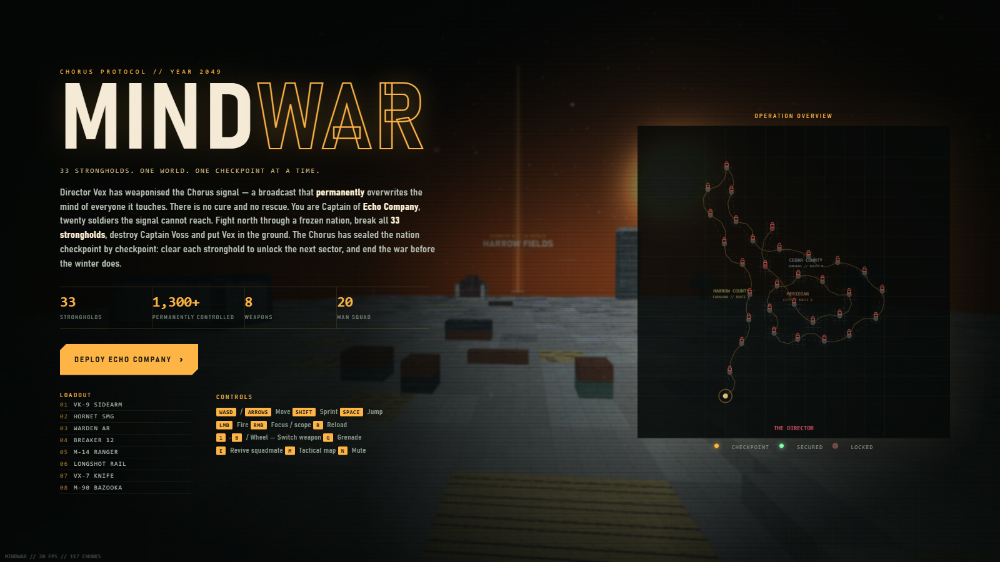

## Run it

```powershell
npm install
npm run dev
```

Or double-click `run.bat` in this folder. Vite prints a local URL
(`http://127.0.0.1:5173`). A skippable **launch intro** plays first: read each Mara transmission
and press **NEXT** to advance, then **ENTER** to reach the title. Add `?nointro` to jump straight to the title. Then click **DEPLOY ECHO COMPANY**, and
the mouse will be captured. A production build is `npm run build` (output in `dist`);
`npm start` builds and serves that output together with the co-op relay.

## Play with others

MINDWAR has online co-op for up to **eight players**. The first player in a room is the host and
owns enemy simulation and checkpoint progression; everyone shares the same waves, zone clears and
finale.

1. Run the game and click **PLAY WITH OTHERS** on the title screen.
2. **CREATE ROOM**, then send the six-character code or the invite link to your friends.
3. Everyone joins, enters a nickname and clicks **READY UP**.
4. The host clicks **START BRIEFING**, everyone reads Mara's briefing with **NEXT**, and clicks
   **READY**. Only when every player is ready does the host's **START MISSION** button unlock;
   the host clicks it to deploy. The host cannot start alone.

Each invite link looks like `http://<host>:<port>/?room=CODE` and opens the lobby with the code
pre-filled.

For players on other machines, serve the built game so the client and the relay share one origin:

```powershell
# Optional but strongly recommended: a long random access key.
$env:COOP_KEY = -join ((48..57) + (65..90) + (97..122) | Get-Random -Count 32 | ForEach-Object {[char]$_})
npm start
```

`npm start` builds `dist` and serves it on `127.0.0.1:8787` by default. For internet play, point a
tunnel such as **cloudflared** or **ngrok** at `http://127.0.0.1:8787` and open the tunnel URL with
`?key=<your key>` once. Invite links preserve both the key and the room code.

For same-network play only, bind to your LAN address:

```powershell
$env:HOST = "0.0.0.0"
npm start
```

Then open `http://<your-lan-ip>:8787/?key=<your key>` and create the room. Keep the Windows
Firewall on and allow Node only on private networks.

Co-op notes:

- The host must stay in the session. If the host leaves, the room closes and the clients return
  to the title screen.
- The host **cannot start alone**. Every joined player clicks **READY UP** in the lobby, then the
  host starts the **briefing**. Each player reads four Mara transmissions with **NEXT**, then clicks
  **READY** on the last one. A host-only **START MISSION** button appears in the briefing, disabled
  until every player has finished reading and clicked READY; the host clicks it to deploy. Clients
  see **WAITING FOR HOST TO START**. If the squad drops below two during the briefing, it cancels
  back to the lobby.
- The briefing has a clearly labelled **EXIT** button in the top-right and **LEAVE CO-OP ROOM**
  at the bottom. Either one leaves the room and returns to the title screen; the operation will
  not start.
- The lobby **NICKNAME** is shown in the roster and above your soldier. Duplicate nicknames get a
  `-2`, `-3` suffix so players stay distinguishable.
- Co-op progress is per-session and is never written to the single-player save.
- Co-op deploys with **Mara as the only AI companion**. She is a tough support shooter:
  2,600 HP, faster reactions, strong accuracy and a steady rifle at about 1.6 times the damage
  of a normal ally.
- Co-op is harder without flooding the map: each checkpoint starts at the **normal solo enemy
  count** and adds **20% for every additional player** (2 players 1.2x, 4 players 1.6x, 8 players
  2.4x). Enemies have **1.75x health** and deal **1.4x damage**, and the simultaneous cap scales
  by the same wave factor.
- A downed player can be revived by a teammate **holding E** nearby for 2.5 seconds. The downed
  player has 30 seconds to bleed out, and can choose to bleed out immediately.
- Press **F** near a teammate to share 20% of your health (up to 150) and 25% of your current
  weapon's reserve ammo. The recipient gets both immediately.
- After every checkpoint, the whole team automatically gets a **field refit**: **+10% damage
  dealt** and **-5% damage taken**. The damage reduction stacks up to a **60% cap**, so the team
  gets stronger without becoming invulnerable. It applies to everyone immediately; there is no
  choice screen and no tradeoff.
- Director Vex has three extra co-op broadcasts: one when the squad deploys, one when a player
  goes down, and one when a player is revived. The host selects the line and sends it to everyone.
- Enemies are simulated by the host. Clients send hit requests and receive enemy snapshots, so
  every player fights the same soldiers and the same boss.
- Co-op uses Mouse + Keyboard; controller support remains under development.
- Friendly fire is on. Bullets can hit the other players; teammate damage reduces their health
  just like enemy fire.
- The host can **kick** a player from the room lobby or from the pause menu's **CO-OP SQUAD** list.

## Keeping the server safe

Running a game server does not give it shell access, but exposing any service from your PC has
risks. The production server only reads `dist/` and relays JSON on `/ws`; it has no upload, eval,
shell or file-write endpoint. The real risks are the Windows account it runs under and bugs in
Node or its dependencies.

- **Never expose the Vite dev server.** `npm run dev` is for your own machine; it serves source
  files, source maps and dev tooling. Use `npm start` for anyone else.
- **Bind to localhost and use a tunnel.** `npm start` listens on `127.0.0.1:8787` by default.
  Point cloudflared/ngrok at that address and share the HTTPS tunnel URL. No router port-forward
  or DMZ is needed.
- **Set `COOP_KEY`.** The page and `/ws` both require the key; the invite link preserves it. Use
  a long random value and do not post it publicly. The room code is a second secret and is now six
  characters.
- **Use HTTPS/WSS.** A tunnel provides this. Plain HTTP over the internet exposes the access key,
  names and traffic to anyone on the path.
- **Run as a normal user**, not Administrator. The server only needs read access to the project
  and `dist/`.
- **Isolate it.** The strongest option is Docker, WSL, a VM or a spare PC with only the game and
  no personal files. If the service is ever compromised, your main files are not there.
- **Keep the firewall on.** Allow Node only on private networks; do not disable Windows Defender
  or the firewall; do not enable UPnP or a DMZ on the router.
- **Shut it down when you are done playing.** Do not leave the port or tunnel running overnight.
- **Update dependencies.** Keep Node current and run `npm audit`; update `ws` and Vite when
  security fixes land.
- The relay also applies same-origin checks, message-size and rate limits, input clamping, and
  host-only simulation messages. Path traversal is rejected by the static server.
- **Limits:** a browser game cannot stop aimbots or wallhacks, and the host is trusted with the
  simulation. An access key also cannot protect against a Node/OS remote-code-execution bug.
  Isolation, updates, TLS and not exposing dev tooling are the real protections.

## Controls

| Input | Action |
| --- | --- |
| `W A S D` / arrow keys | Move |
| Mouse | Look |
| `Shift` | Sprint |
| `Space` | Jump |
| Left mouse | Fire |
| Right mouse | Aim / tighter spread. Scoped rifles: hold for the optic |
| `X` / middle mouse | Quick knife punch, regardless of the equipped weapon |
| `R` | Reload |
| `1` - `7` / mouse wheel | Switch weapon |
| `G` | Throw a frag grenade |
| `E` | Engage the next checkpoint / revive a downed squadmate; hold for 2.5 s to revive a downed co-op player |
| `F` | Share health and ammo with a nearby co-op teammate |
| `M` | Tactical map |
| `N` | Mute / unmute audio |
| `Esc` | Pause / release mouse |

**Input:** Mouse + Keyboard is the active control scheme. **Controller support is under
development** and disabled for now, so a connected pad cannot interfere with mouse or keyboard
play. The title screen shows the controller option as an under-development sign.

Click the game again if the pointer lock is released.

If your browser or embedded preview pane blocks pointer lock, MINDWAR detects it automatically:
hold the **right mouse button and drag** to look, and left-click to fire. For real mouse capture,
open the Vite URL in a normal Chrome/Edge tab.

## The campaign

The world is a single deterministic voxel map, generated in 16 x 16 chunks around the player.
The 33 strongholds sit on a curved National Route 9 across a much larger country - farmland,
suburban towns and the capital. Every battle is part of the same world; no level loads and no
separate maps. Local farm lanes, suburban loops and city grids branch off the highway.

- **Strict checkpoint chain**: only the next checkpoint can be entered. Later strongholds are
  sealed behind red containment fields, their beacons are dimmed and the tactical map marks
  them with padlocks and dashes the route beyond the next objective. Clearing a checkpoint
  moves the containment field forward to the following sector.
- **Battles start manually or automatically**: stand at the next checkpoint and press **E** to
  open a confirmation, or open the tactical map and click the amber next-checkpoint marker. Both
  routes show the checkpoint name, region and hostile count with **START BATTLE** and **CANCEL**.
  Walking within **68 m** of an unbeaten gate also starts the battle automatically, as it did
  before the confirmation prompt existed, so a fresh gate cannot be walked past or ignored. The
  map confirmation still allows an early start from anywhere.
- **33 strongholds**, each with a live battle: 18 hostiles at Harrow Fields, rising to 38 at
  Voss's Gate and 44 at the Director's tower. The Army of the Chorus totals about 1,380 soldiers,
  spawned in waves.
- **Winter war**: the whole nation is snowbound. Cold fog and pale sunlight, snow-capped surfaces,
  frost-rimed roofs and fields, and constant wind-driven snowfall that follows the camera.
- **Two-stage command chain**: **Captain Voss** holds the 32nd stronghold with 3,400 HP and a
  guard detail. Killing him opens the inner gate and drops his local command network. **Director
  Vex** waits in the 33rd with 7,800 HP and his praetorians.
- **Regions**: Harrow County farmland with crop fields, barns, silos, fences and orchards;
  Cedar's Vill with detached houses, yards, loop roads and flat-roof stores; Meridian
  city with dense blocks, warehouses, street grids and rooftop strongpoints. Every highway is
  cleared of structures, canopies and cover props, and the containment pylons skip road tiles.
- **Seven enemy roles**: conscripts, riflemen, fast scouts, shotgun breachers, heavily armoured
  gunners, radio officers and dedicated snipers. Each role has its own detailed voxel model,
  health, weapon, range, burst pattern, movement and accuracy.
- **Realistic spotting and reactions**: enemies see through wide forward vision cones with line
  of sight, idle-scan when unaware, investigate the last known position, flinch and turn toward
  whoever shot them, and return fire after a short reaction delay. Gunfire is the loudest cue:
  it sharply raises local alertness, nearly doubles their noticing distance, widens their vision
  arc and sends the whole nearby force to investigate. Explosions and nearby deaths do the same.
  Enemies also steer around trees instead of walking through them.
- **Rooftop snipers only**: snipers spawn on flat roofs, clamp themselves to the roof bounds,
  never jump or fall off, reposition for a firing line, flash a scope glint before firing and
  hit hard. All other enemy roles are restricted to ground-level spawns.
- **7 holdable weapons, knife punch and grenades**:
  VK-9 sidearm, Hornet SMG, Warden AR, Breaker 12 shotgun, M-14 Ranger DMR,
  Longshot railgun and M-90 bazooka. Every gun's magazine capacity is doubled. The semi-automatic
  M-14 carries 24 + 180 rounds and a 3.0x optic; the Longshot is a 10-round anti-materiel railgun
  with a 4.0x optic and a 1.3 s reload; the M-90 loads two rockets and reloads in 1.45 s. `X` or
  middle mouse performs a quick 260-damage knife punch without taking up a weapon slot. The
  bazooka fires a real travelling rocket with a 14 m blast radius. `G` throws a long-arc bouncing
  frag grenade with an 11 m blast radius, a 2.5-second fuse and roughly 25 m of throw distance. Ammo
  crates also add grenades and bazooka rockets. All seven gun view models use machined composite
  panels, glowing cyan data buses, carbon-fibre furniture and edge lights.
- **Aiming and explosives**: aiming tightens every gun; scoped first shots are near-pinpoint
  and zoomed optics scale mouse sensitivity. Rockets and grenades use real projectile travel,
  wall collision, fuse/bounce behaviour and falloff explosion damage.

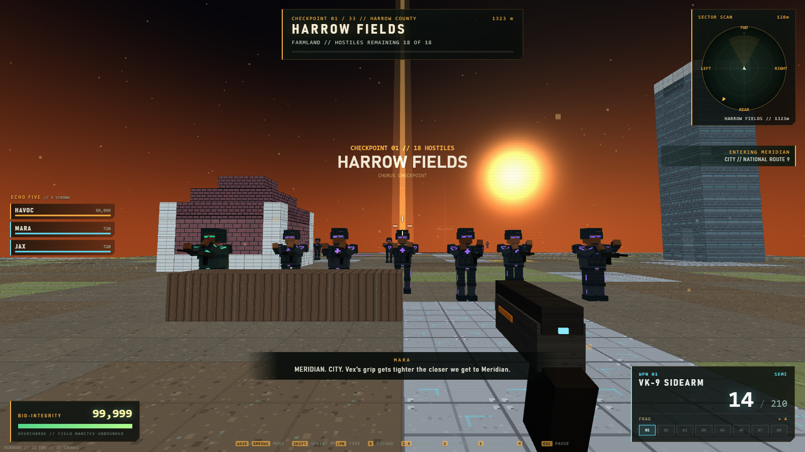

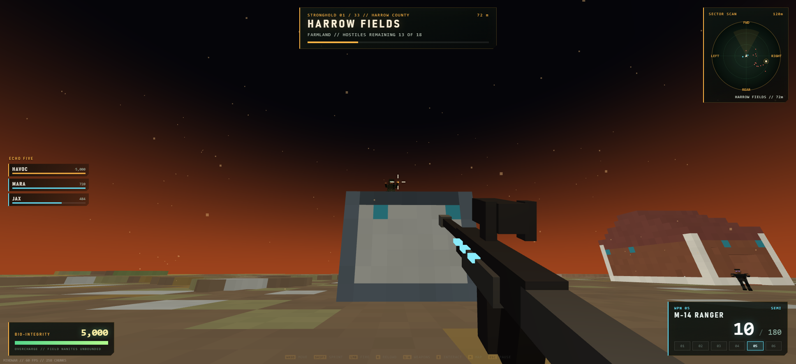

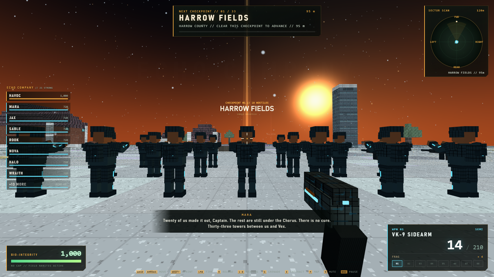

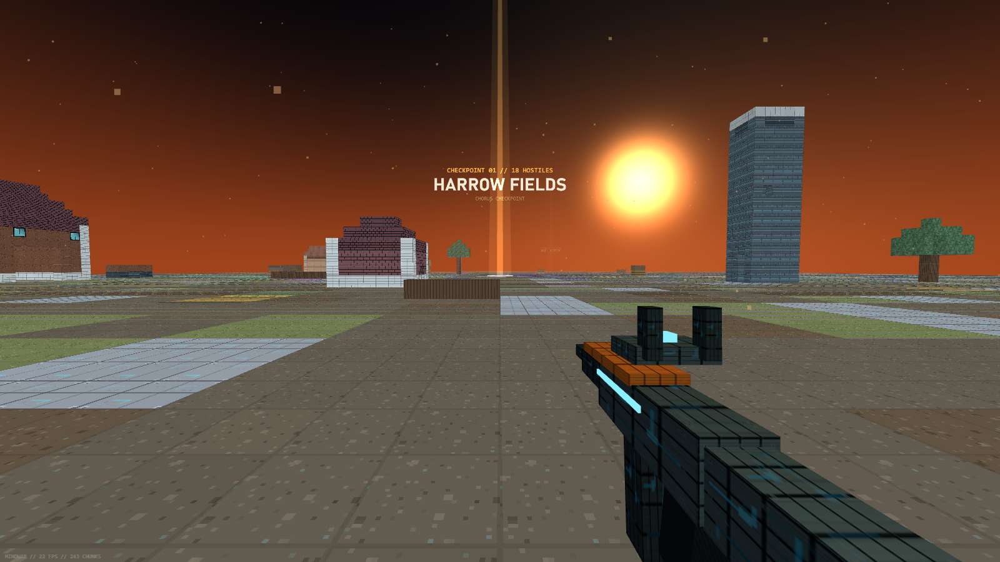

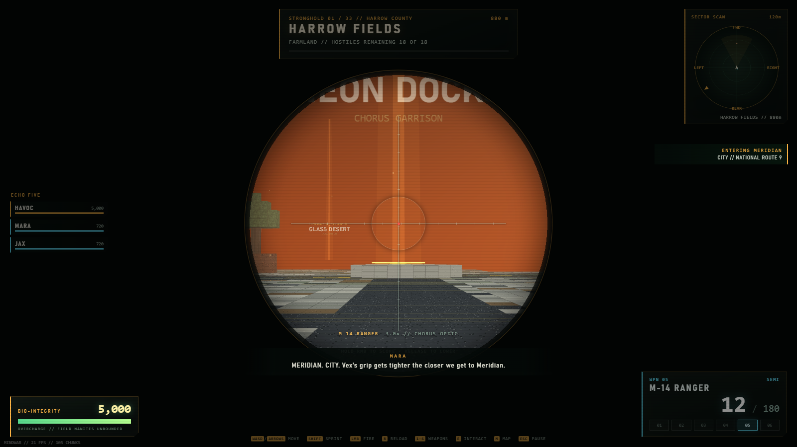

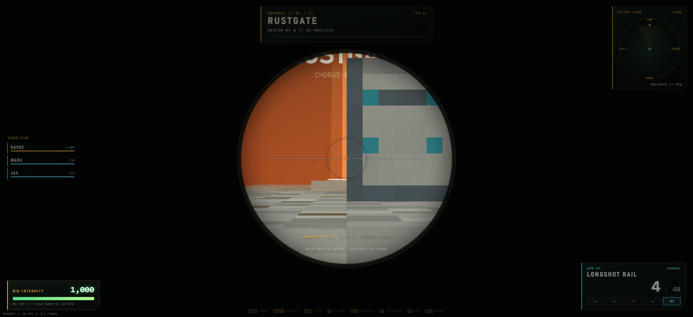

- **Launch cinematic**: a short descending camera flyover with the MINDWAR title reveal and three
  of Mara's intro radio lines, shown one at a time with a live signal animation. Each line waits for
  the **NEXT** button (the last one reads **ENTER**), so nothing advances on a timer; **SKIP INTRO**
  and invite links / `?nointro` bypass it.
- **Player power fantasy**: 1,000 starting integrity versus 58-250 HP soldiers, and weapons
  that one-shot or two-shot body targets. Health and reserve ammunition pickups have **no cap**.
- **Mara at your side**: Echo Company deploys with Mara as your only AI squadmate.
  She follows, takes cover, shoots independently, goes down, and can be revived with `E`.
  Mara has 2,600 HP, faster target acquisition, a higher rate of fire, decent accuracy and
  headshot-capable damage. She engages out to 36 m, carries a 20-round magazine and pauses to
  reload when it runs dry. She deliberately holds fire on untouched enemies farther than 22 m
  from the player and only helps with them after someone has damaged them, giving the player
  first contact. She also leaves a nearly-dead enemy the Captain has already hit
  (below 40% health within the last 5 s) for the Captain to finish. The HUD shows the full
  headcount and collapses excess cards into a +N summary.
- **Climbable ladders**: every building has a metal wall ladder on the outside of one wall.
  Ladders are thin wall-mounted plates (about 4 cm deep), not metre-thick blocks, so they no
  longer fill the camera when you climb or walk past them. Walk into the ladder and hold forward
  to climb, back to descend. The top rung meets the roof
  so you can step straight off; flat-roof parapets are notched at the ladder. Squadmates and
  enemies use the same ladders to follow you onto rooftops, and enemies no longer snap to a roof
  when they brush against a wall.
- **Permanent control**: the Chorus cannot be cured. There are no survivors to recruit and no
  conscripts to free; every mind-controlled soldier stays hostile until put down.
- **Finale**: when Vex dies, the red sky breaks and a column of light ends the Director. The sky
  turns free blue and a colossal mountain descends gently to rest on the earth. The campaign ends
  in peace, and the victory screen reflects the new ending.
- **Runtime-generated textures**: a futuristic 256 x 256 block atlas with dark composite
  panels, luminous seams, circuit traces, solar roofs and illuminated glazing; cyan highway
  light-guide studs; a neon skyline; procedural carbon-weave, machined armour, skin, metal and
  visor patterns for every soldier model plus emissive visor, chest, shoulder, backpack and limb
  strips; and stencilled health/ammo crates. The first-person guns and knife use clean, untextured
  flat colours. No external image assets are used.
- **Five-world campaign archive**: **DEPLOY ECHO COMPANY** starts a new world in the first empty
  slot. **LOAD CAMPAIGN** lists all five worlds with their secured count, kills and last area;
  each saved world has **LOAD** and **DELETE**, and empty worlds have **START**. **CONTINUE
  OPERATION** resumes the active world, and autosaves are written only to that world.
- **Auto-saving** after zone clears and every few seconds, per world.

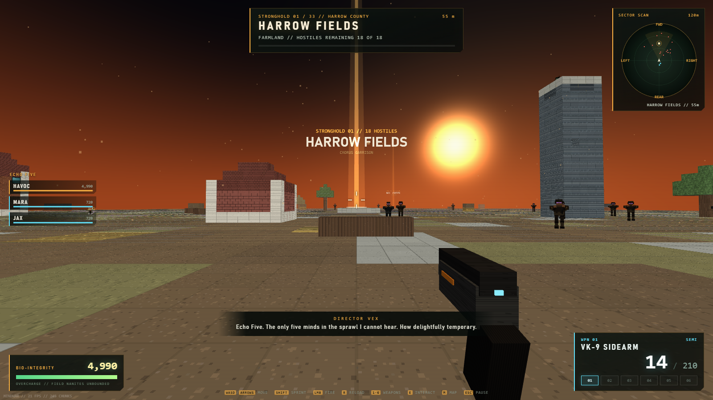

Meridian's blocks are tall enough to hide a sniper on almost every roof:

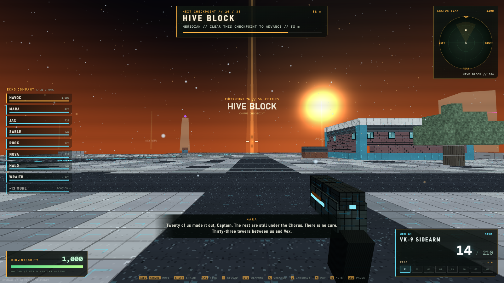

## Interface

- Live health, ammunition, weapon slots and squad status.
- Radar that shows enemies, allies, bosses, beacons and the next objective.
- A full tactical map of the nation with region labels and local roads.
- Battle banners, radio traffic, kill/hit markers, damage vignette and zone-clear rewards.
- Pause, death/redeploy, victory and continue-operation flows.
- Procedural audio: every gunshot, reload, pickup, alarm and footstep is synthesised with
  WebAudio. No asset files are used.
- **Piano-only score with regional exploration themes**. The title theme is a soft 66 BPM piano
  piece in A minor / Fmaj7 / Dm / Em. Every four-bar pass randomly chooses one of four lead
  melodies (including a rising second theme), one of four broken-chord shapes and one of four
  left-hand root/fifth patterns, so the loop keeps changing and the lead never repeats twice in
  a row. Exploration uses three regional themes: **Harrow County** at 60 BPM (open Em–C–G–D),
  **Cedar's Vill** at 72 BPM (colder Dm–B♭–F–C), and **Meridian**, which uses **Vex's darker,
  50 BPM chromatic Dm–B♭–A♭–A theme** with a low register and dark cutoff. The normal battle
  track is a tense 118 BPM variation of the battle
  harmony, rotating through four lead/answer phrases with a driving left-hand ostinato. The last
  two checkpoints — **Voss's Gate** and **The Director** — use a separate **126 BPM epic final
  battle theme**: a broad D–F–G–A lead with octave doubling, high bells, a heavy ostinato and low
  tolling octaves, built from Vex's material. No drums or synth pads are used.
  The title theme starts as soon as the page loads where the browser allows autoplay, and falls
  back to the first click/key press when it does not. It plays on the title and menu screens; the
  regional theme plays while exploring that region and the correct battle or final-battle theme
  starts when a checkpoint activates. `N` mutes everything. To listen to the full score outside the
  game, open **`/score.html`** (or `public/score.html` from disk): it runs the same piano engine
  with buttons for **Title**, **Harrow County**, **Cedar's Vill**, **Vex's theme**, **Battle**,
  **Final Battle** and **Stop**, plus a volume slider. Its **NOW PLAYING** panel updates live with
  the current movement or variant, showing a name, a short description and BPM/key/arrangement
  details (e.g. `HARROW COUNTY // FARMLAND`, `TITLE // ASCENT`, `BATTLE // HAMMER`).

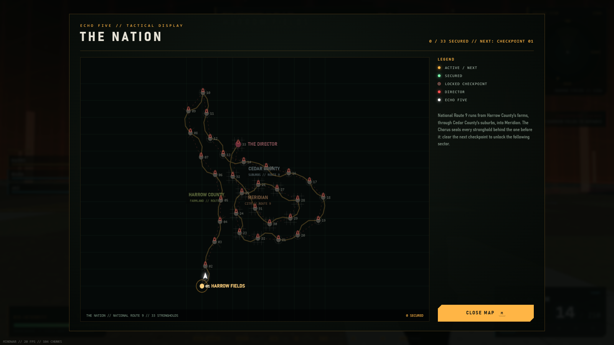

Sealed checkpoints are physically fenced by a red containment field until their turn:

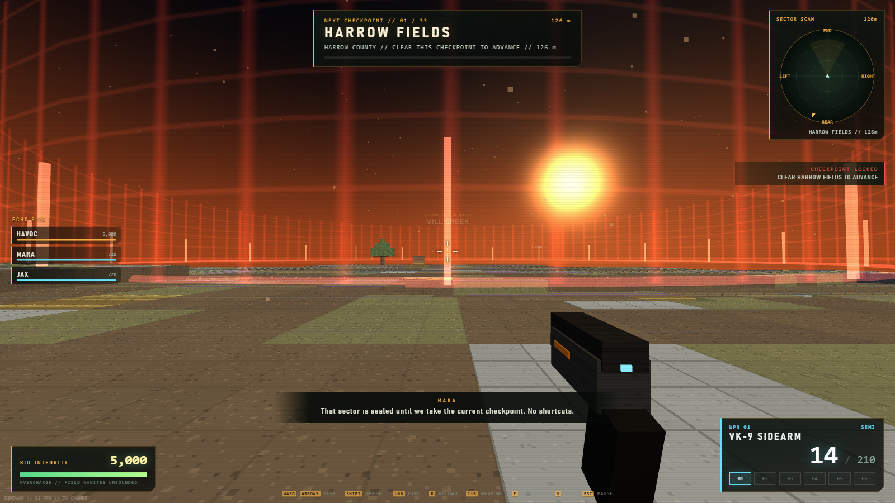

Captain Voss holds the inner gate before the Director:

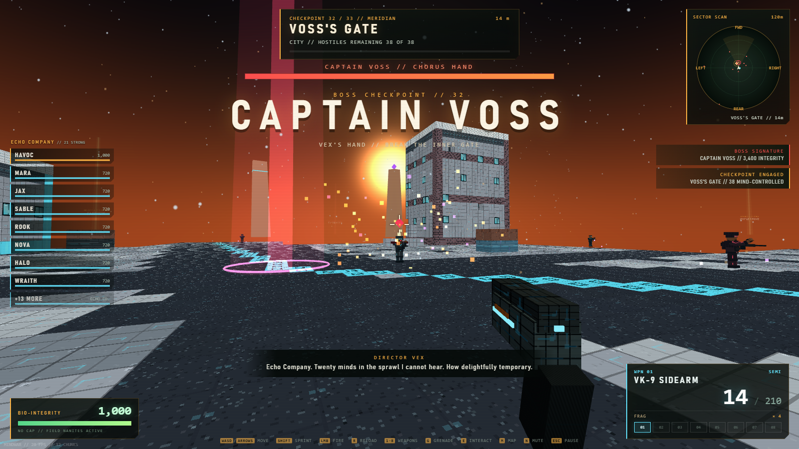

Break the Chorus and the campaign ends with the falling Director, the breaking sky and the
descending mountain:

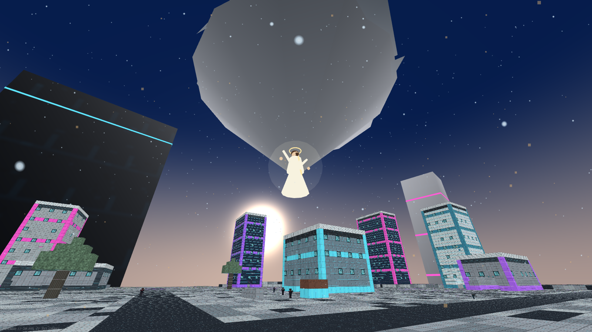

...followed by the peace debrief:

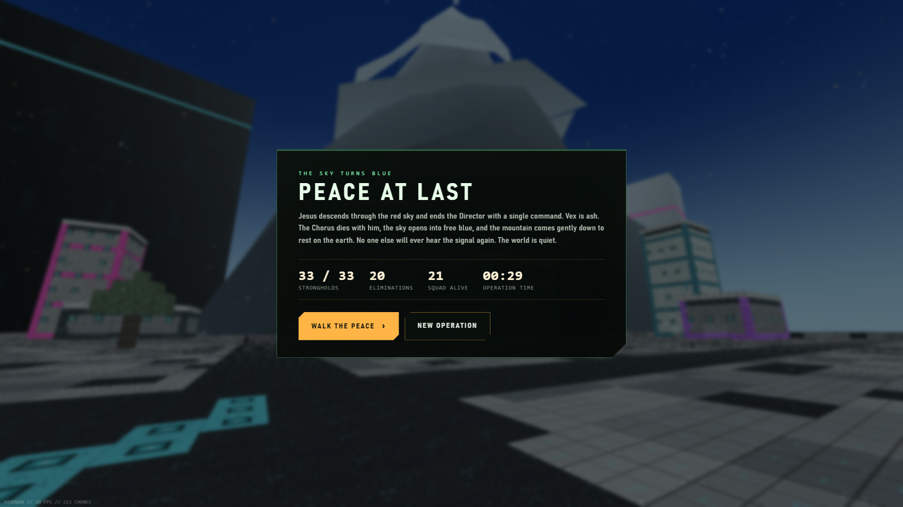

## Implementation

| File | Role |
| --- | --- |
| `src/main.js` | Renderer, red/blue sky lighting, game states, input, campaign flow, save/continue, menus, light/mountain finale |
| `src/world.js` | Chunk generation, winter block atlas, textured meshing, regional terrain, roads, roofs, trees, beacons, snowfall, collision, voxel raycasts |
| `src/zones.js` | National route, regional road network, 33 strongholds, farms/suburbs/city props and spawn layout |
| `src/player.js` | First-person movement, voxel collision, step-up, camera, health, interaction |
| `src/weapons.js` | Seven weapon definitions, knife punch, rocket/grenade projectiles, view models, recoil, reloads, optics |
| `src/enemies.js` | Seven enemy roles, detailed voxel models, FOV/LOS spotting, hit reactions, tree avoidance, rooftop sniper AI, 20-ally squad AI, Captain Voss, the Director, 33 battle states |
| `src/pickups.js` | Unbounded health/ammo drops |
| `src/effects.js` | Pooled tracers, muzzle flashes, impact particles and explosions |
| `src/hud.js` | HUD, radar, regional campaign map |
| `src/audio.js` | Runtime WebAudio synthesis |
| `src/coop.js` | Co-op lobby, remote player avatars, host enemy snapshots, client puppets, shared events |
| `src/net.js` | Browser WebSocket client for the co-op relay |
| `server/rooms.js` | Room codes, eight-player rosters, host-authoritative message relay |
| `server/index.js` | Production static server plus the co-op relay |
| `src/style.css` | Interface, scope overlay, menus and overlays |

World rendering uses one merged, vertex-coloured `BufferGeometry` per 16 x 16 chunk with hidden
faces culled and per-face lighting baked into the colours. Chunks stream in nearest-first and
unload behind the player. Collision and hitscan share the same voxel data, and the renderer
draws one material for all terrain.

## Verification

The game was driven in Chromium at 1600 x 900 during development:

- steady 60 FPS with 213-255 streamed chunks and 52-65k triangles on screen;
- full battle loop verified - checkpoint confirmation, wave spawning, squad damage, enemy deaths,
  supply drops, zone clear, beacon colour change and squad revive prompt;
- seven enemy roles observed in the live spawn mix; every rooftop occupant was a sniper and
  every non-sniper stayed at ground height;
- sniper roof-clamp and repositioning verified over an 8-second observation: fixed roof height,
  aim/glint wind-up, firing and damage to the player;
- 0 buildings intersect any road cell across all 33 zones;
- checkpoint locking verified: entering a future sector was clamped at 101.2 m from its
  centre and the red containment field appeared; after clearing the previous checkpoint the
  next checkpoint could be confirmed and started normally;
- manual checkpoint start verified both ways: pressing E at the next beacon opened the
  confirmation and START BATTLE spawned the wave; clicking the next checkpoint on the map opened
  the same confirmation, and cancelling restored the map or gameplay without starting;
- automatic gate start verified: walking within 68 m of the next unbeaten gate activated the
  battle without pressing E, matching the original trigger; the map confirmation still allows an
  early start from anywhere;
- five-world archive verified: starting WORLD 02 made it the active world and saved there, loading
  it restored that world, and clearing it left WORLD 01 untouched;
- all 32 future checkpoints are marked LOCKED on the map at the start of a new operation;
- per-world save/continue restores cleared zones, allies, health and ammo;
- death/redeploy, pause, tactical map, Captain Voss, Director Vex and the full light/mountain
  finale all exercised;
- ADS accuracy tightened across all guns; the DMR and Longshot scopes verified at 30 / 22 FOV
  with the view model hidden, working mil reticles and sub-0.0002 rad first-shot spread;
- weapon capacity/reload verified: every gun's magazine doubled (VK-9 28, Hornet 90, Warden 72,
  Breaker 16, Ranger 24, Longshot 10, M-90 2), with the Longshot at a 1.3 s reload and the
  bazooka at 1.45 s;
- M-14 semi-automatic behaviour verified (one round per click) with 24 + 180 ammo;
- knife punch arc verified: a close punch killed a conscript instantly;
- grenade fuse/projectile behaviour verified, and a direct bazooka rocket hit killed a
  150 HP breacher;
- two-strong starting squad verified: Echo Company deployed Mara as the only ally, the HUD showed
  "2 STRONG", and she was revivable;
- enemy vision verified front/back: a target in the forward cone was acquired, while the same
  target behind an unaware enemy was not;
- damage reaction verified: enemies immediately target the shooter after being hit, flinch,
  and delay return fire for a short reaction window;
- death alerts verified: killing one enemy set a nearby witness to alerted and pointed it at the
  body's last known position;
- gunfire alert verified: a shot set combat alert for the local force and expanded their
  detection range and vision arc;
- squad firepower verified: allies now have 900 HP and a headshot shot dealt 83 damage, killing
  a 58 HP conscript;
- squad follow verified: an ally with no target followed a nearby alerted ally;
- tree avoidance verified: a dummy AI pushed straight at a tree trunk was deflected outward and
  never entered the trunk;
- permanent-control flow verified: no survivor or recruit prompts appear, and every
  mind-controlled soldier remains hostile;
- winter pass verified: cold sky/fog, snow-capped terrain and 1,800 falling snow particles;
- two-stage boss chain verified: Voss spawned at 3,400 HP in zone 32, his death cleared the
  zone and advanced to zone 33, and Vex spawned at 7,800 HP;
- the finale ran through the light column, the Director's destruction, the red-to-blue sky blend,
  the gentle mountain landing at y=0 and the "PEACE AT LAST" victory screen without console errors;
- both music modes verified as piano-only arrangements with the audio context running and the
  sequencer advancing; the title theme started automatically on page load, stayed on during
  exploration, switched to the battle variation when a checkpoint activated and returned to the
  title theme when the checkpoint cleared; the game mix was raised from 0.19/0.22 to 1.7/1.5
  (title/battle) and the battle switch was confirmed live at 1.5 gain with the battle sequencer
  stepping while the title sequencer was silent;
- title-theme variation verified: 12 consecutive selections covered all four lead melodies and
  12 distinct melody/arpeggio/bass combinations with no repeated lead, and the live sequencer
  rotated from `ascent/0/3` to `descent/1/0` after one four-bar cycle; the standalone score page
  uses the same variation set;
- battle-theme variation verified: 12 consecutive selections covered all four battle phrases
  (assault, counter, rise, hammer) with no immediate repeat, and the live battle sequencer
  rotated from `counter` to `hammer` after one four-bar cycle; the score page matches;
- score-player verified: Title, Harrow County, Cedar's Vill, Vex, Battle and Final Battle buttons
  switched modes and levels (2.0/2.0/2.0/2.0/1.7/1.85), the NOW PLAYING panel showed the matching
  theme text, and title/battle rotations still update live with each variant;
- regional score verified: deploying in Harrow County set the 60 BPM farm theme, teleporting to
  Rustgate switched to the 72 BPM suburb theme, Neon Docks switched to Vex's darker 50 BPM city theme,
  a normal checkpoint activated the 118 BPM battle theme, and zone 31 activated the 126 BPM final
  battle theme; all switches ran without console errors;
- ally separation verified: two allies placed in the same position pushed apart on their next
  update;
- X-key and middle-mouse knife punch verified: both hid the equipped gun, showed the knife swing,
  dealt knife damage and restored the previous weapon view model;
- ladders verified on flat, gable and hip roofs: the player climbed from street level to the
  roof, stepped onto it and descended again; a guard pathed to a ladder from across the street,
  climbed at 3.2 m/s and stepped onto the roof; an ally followed the Captain up the same ladder;
- no roof snapping verified: a guard walking into a wall beside a building stayed at ground
  height, and no agent made a single-frame vertical jump (largest climb step 0.053 m);
- co-op relay verified with two WebSocket clients: room create/join, six-character code, roster,
  host id on start, player-state relay with names, damage routed to the host, enemy snapshots,
  host hit routing and peer-leave removal;
- two-client co-op verified in Chromium: host and client both deployed, five squadmates each,
  avatars appeared at the other player's position and yaw, five host enemies appeared as client
  puppets with matching health, client damage reduced the host enemy's health, host damage reduced
  the client's health, checkpoint-active and checkpoint-clear events applied on the client, and the
  finale event put the client into the ending sequence without console errors;
- solo deployment still works with the co-op relay present, and co-op sessions never write the
  single-player save;
- friendly fire verified: a host shot hit a client and dropped their health, a client shot hit the
  host, and, in solo, a stray shot damaged an AI squadmate; friendly hits do not count as enemy
  kills;
- launch intro verified: the descending camera and three random Mara radio lines play while the
  title screen is hidden; every line stayed put until NEXT was pressed (no auto-advance after a
  timed wait), the last line showed ENTER and opened the title, SKIP INTRO worked,
  `?nointro`/invite links bypassed it, and there were no console errors;
- co-op lobby and briefing verified: the host could not start alone, the start stayed disabled
  until the joining player clicked READY UP, the briefing showed four Mara transmissions with a
  working NEXT button and READY on the last line, the host's START MISSION button stayed disabled
  until the client was ready and then started both players, the client did not get the button and
  saw WAITING FOR HOST TO START, and both players deployed together; a duplicate nickname was
  uniquified (`HOST-NICK`
  became `HOST-NICK-2`);
- co-op Vex transmissions verified: the host broadcasts the deployment taunt to every player, and
  the downed/revived moments are sent to the team with the affected player's nickname;
- co-op difficulty and support verified: Mara was the only AI ally, checkpoint totals scale
  1.2x/1.6x/2.4x for 2/4/8 players, enemy health and damage multipliers are 1.75x/1.4x,
  health/ammo sharing routed
  between clients, the
  post-battle field refit automatically applied +10% damage dealt and -5% damage taken (capped at
  -60%) to every player in sequence, and
  a downed player was revived by another player holding E;
- Mara verified as an expert ally: 2,600 HP, expert flag active, 0.012 spread, 36 m engagement
  range, 20 base rifle damage, a 20-round magazine with a 2.0 s reload, a 0.75-1.0 s fire interval,
  a 1.0-1.5 s reaction delay before opening fire, and the ally line-of-sight gate now lets her
  engage instead of holding fire; host-authoritative and mirrored to clients as a single network
  puppet;
- Mara's support behaviour verified: a full-health target 30 m from the player was ignored until
  damaged, and she only opened fire after the reaction delay;
- ally fire rebalanced and verified: Mara at 24 m hit about 89% with few headshots after the
  spread/aim change; riflemen stop acquiring targets past 40 m;
- ally damage share verified: Mara dealt about 22 DPS over a 6 s test after the support rebalance
  (down from roughly 83 DPS, and 1,000 DPS before the earlier cuts), so the player gets most of
  the damage and the kills;
- kill-claim verified: a low-health enemy the player had just damaged was ignored by Mara and
  left alive for the player to finish;
- ally reload verified: Mara fired a 20-round magazine empty, entered the 2.0 s reload and came
  back with a full magazine; Jax uses a 24-round magazine and a 2.8 s reload on the same path;
- hold-E player revive verified end to end: host downed, client held E for 2.5 s, host returned to
  play at 400 HP with the downed screen closed;
- Vex verified with two additional elite praetorian guards spawned beside him (two heavies within
  12 m of the Director), plus the existing wave and summons;
- first-person gun and knife rigs verified with zero texture maps; the view models use flat
  untextured colours;
- Mara's radio pool verified across intro, co-op, region, engage, clear, low-health, downed,
  revived, share, upgrade and boss categories with non-repeating random lines;
- controller support is visibly marked **UNDER DEVELOPMENT** and disabled; gamepad input is
  ignored entirely, so a connected third-party controller cannot auto-fire or move the player;
- runtime texture atlas and per-material pattern maps verified in a headless Chromium render
  for terrain, buildings, soldiers, pickups and the city; atlas filtering and edge treatment were
  softened so adjacent block textures read less like separate tiles; held guns and the knife now
  use flat untextured colours;
- WASD and keyboard arrow-key movement verified; mouse fire/aim works normally;
- production build passes (`npm run build`).
